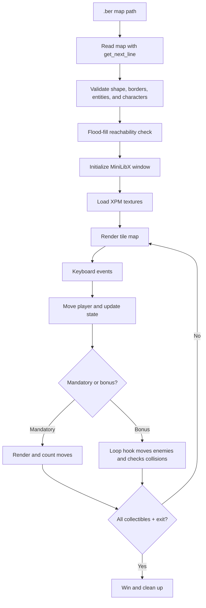

# So Long — 42 Cursus

[](https://en.wikipedia.org/wiki/C_(programming_language))
[](https://github.com/42Paris/minilibx-linux)

A small 2D top-down game written in C with [MiniLibX](https://github.com/42Paris/minilibx-linux), developed as part of the 42 School curriculum. The player navigates a tile-based map, collects every collectible, and reaches the exit. The repository contains both the mandatory implementation and the bonus implementation with moving enemies and player animation.

> **Repository status:** The project builds through the included `Makefile`. No automated test suite, CI workflow, database, API, Docker configuration, or license file is currently included.

## Contents

- [Features](#features)
- [Visual Preview](#visual-preview)
- [Tech Stack](#tech-stack)
- [How It Works](#how-it-works)
- [Project Structure](#project-structure)
- [Prerequisites](#prerequisites)
- [Installation and Setup](#installation-and-setup)
- [Usage](#usage)
- [Map Format](#map-format)
- [Controls](#controls)
- [Testing and Code Quality](#testing-and-code-quality)
- [Troubleshooting](#troubleshooting)
- [Contributing](#contributing)
- [License](#license)
- [Author](#author)
- [Acknowledgments](#acknowledgments)

## Features

### Mandatory implementation

- Reads maps from `.ber` files.
- Validates the file extension, map dimensions, rectangular shape, wall borders, allowed characters, and required entities.
- Requires exactly one player (`P`), exactly one exit (`E`), and at least one collectible (`C`).
- Uses flood-fill validation to ensure every collectible and the exit are reachable from the player.
- Renders the map with MiniLibX and XPM textures.
- Supports movement with `W`, `A`, `S`, and `D`.
- Blocks movement through walls and prevents entering the exit until all collectibles are collected.
- Counts player moves and prints the count to standard output.
- Exits cleanly when the player wins, presses `Esc`, or closes the window.

### Bonus implementation

- Adds enemies represented by `N` in the map.
- Requires at least one enemy in a bonus map.
- Moves enemies through the MiniLibX loop hook with horizontal and vertical direction changes when blocked.
- Detects collisions between the player and enemies and ends the game with `Game Over`.
- Adds directional player textures and movement animation.
- Renders the move counter inside the game window.

## Visual Preview

Add screenshots or a short gameplay recording to the repository and replace the placeholders below with the corresponding relative paths:

```md


```

The repository does not currently include a `docs/images/` directory or committed screenshots.

## Tech Stack

| Area | Technology | Verified usage |
| --- | --- | --- |
| Language | C | Application and game logic |
| Graphics | MiniLibX | Window creation, keyboard/window hooks, image rendering, loop hook |
| Assets | XPM | Wall, floor, player, collectible, exit, and enemy textures |
| Build | GNU Make | Mandatory and bonus targets plus cleanup commands |
| Compiler settings | `cc`, `-Wall -Wextra -Werror` | Defined in the root `Makefile` |
| Platform integration | OpenGL and AppKit frameworks | Linked by the current Makefile |

There is no application server, database, HTTP API, authentication layer, package manager manifest, Docker configuration, or environment-variable configuration in this repository.

## How It Works

The program follows a simple event-driven game loop:

1. `Mandatory/so_long.c` or `Bonus/so_long_bonus.c` validates the command-line argument and opens the `.ber` map.
2. `check_map.c` validates the map shape, borders, entities, and allowed characters.
3. `flood_fill.c` checks that all collectibles and the exit can be reached from `P`.
4. MiniLibX creates a window and loads the XPM textures from `textures/`.
5. The keyboard callback updates the player position and move count.
6. The bonus loop hook periodically moves enemies and checks for collisions.
7. Cleanup functions release map, window, MiniLibX, file, and enemy resources when the game exits.



## Project Structure

```text
.
├── Mandatory/
│   ├── so_long.c                 # Mandatory entry point and MiniLibX initialization
│   ├── so_long.h                 # Mandatory game state and function declarations
│   ├── check_map.c               # Map loading and validation
│   ├── flood_fill.c              # Reachability validation
│   ├── draw_map.c                # Texture loading and map rendering
│   ├── events.c                  # Keyboard input and player movement
│   ├── move_count.c              # Move-count output
│   ├── free_data.c               # Map and window cleanup
│   └── get_next_line*.c          # Line-oriented file reading helpers
├── Bonus/
│   ├── so_long_bonus.c           # Bonus entry point and game-loop setup
│   ├── so_long_bonus.h           # Bonus game and enemy structures
│   ├── check_map_bonus.c         # Bonus map validation, including enemies
│   ├── flood_fill_bonus.c        # Bonus reachability validation
│   ├── render_map_bonus.c        # Bonus rendering and player animation
│   ├── load_img_bonus.c          # Bonus texture loading
│   ├── events_bonus.c            # Bonus keyboard input and movement
│   ├── enemy_bonus.c             # Enemy creation, loop updates, and collisions
│   ├── move_enemy_bonus.c        # Enemy direction and movement logic
│   ├── move_count_bonus.c        # In-window move counter
│   ├── free_data_bonus.c         # Bonus cleanup helpers
│   └── get_next_line_bonus*.c    # Bonus line-reading helpers
├── maps/
│   ├── map.ber                   # Example mandatory map
│   └── map_bonus.ber             # Example bonus map
├── textures/                     # XPM graphics used by the game
├── Makefile                      # Build, bonus, cleanup, and rebuild targets
├── Subject.pdf                   # 42 project subject
└── README.md
```

## Prerequisites

The current Makefile is configured for a Unix-like environment with a MiniLibX installation and links the macOS frameworks `OpenGL` and `AppKit`.

Install or make available:

- A Unix-like operating system.
- A C compiler exposed as `cc`.
- GNU Make.
- MiniLibX, including its `mlx.h` header and linker library.
- On macOS, the OpenGL and AppKit frameworks used by the Makefile.

The repository does not pin compiler, operating-system, or MiniLibX versions. On Linux, the linker flags normally need to be adapted to the local MiniLibX implementation and system libraries.

## Installation and Setup

### 1. Clone the repository

```bash
git clone https://github.com/A-chem/So_long-42-Cursus.git
cd So_long-42-Cursus
```

### 2. Verify MiniLibX availability

Before building, confirm that the compiler can find `mlx.h` and the MiniLibX library. The exact installation path is platform-specific and is not managed by this repository.

### 3. Build the mandatory version

```bash
make
```

This creates the `so_long` executable from the sources in `Mandatory/`.

### 4. Build the bonus version

```bash
make bonus
```

This creates the `so_long_bonus` executable from the sources in `Bonus/`.

## Usage

The executable accepts exactly one argument: the path to a valid `.ber` map.

### Mandatory game

```bash
./so_long maps/map.ber
```

### Bonus game

```bash
./so_long_bonus maps/map_bonus.ber
```

The game window is sized from the map dimensions using 50-pixel tiles. The implementation rejects maps that would produce a window wider than 2550 pixels or taller than 1400 pixels.

## Map Format

Maps are rectangular grids using one character per tile:

| Symbol | Meaning | Mandatory | Bonus |
| :---: | --- | :---: | :---: |
| `1` | Wall | Yes | Yes |
| `0` | Walkable floor | Yes | Yes |
| `P` | Player start position | Exactly one | Exactly one |
| `C` | Collectible | At least one | At least one |
| `E` | Exit | Exactly one | Exactly one |
| `N` | Enemy | Not accepted | At least one |

A valid map must:

- Use the `.ber` extension.
- Be rectangular and contain no empty lines.
- Be completely enclosed by `1` tiles.
- Contain only the symbols supported by the selected executable.
- Have reachable collectibles and an exit according to the flood-fill check.

Example mandatory map:

```text
1111111111111
10010000000C1
1100011110101
1P011CE000001
1111111111111
```

Example bonus maps are available in [`maps/map_bonus.ber`](./maps/map_bonus.ber).

## Controls

| Key | Action |
| :---: | --- |
| `W` | Move up |
| `A` | Move left |
| `S` | Move down |
| `D` | Move right |
| `Esc` | Exit the game |
| Window close | Exit the game |

The exit can only be completed after all collectibles have been gathered. In the bonus version, contact with an enemy ends the game.

## Build Commands

| Command | Effect |
| --- | --- |
| `make` | Build the mandatory `so_long` executable |
| `make bonus` | Build the bonus `so_long_bonus` executable |
| `make clean` | Remove mandatory and bonus object files |
| `make fclean` | Remove object files and executables |
| `make re` | Run `fclean` and rebuild the mandatory version |

## Testing and Code Quality

No automated tests, test target, linter, formatter, or CI workflow is included. The build uses strict compiler warnings:

```text
-Wall -Wextra -Werror
```

A basic local validation workflow is:

```bash
make fclean
make
./so_long maps/map.ber

make fclean
make bonus
./so_long_bonus maps/map_bonus.ber
```

Manual checks should include valid maps, malformed or non-rectangular maps, missing or duplicated entities, unreachable collectibles or exits, wall collisions, successful completion, `Esc`, window closing, and bonus enemy collisions.

## Troubleshooting

### `mlx.h` cannot be found

MiniLibX is not installed in a compiler-visible include path. Install MiniLibX for your platform or update the Makefile/include configuration to point to the local installation.

### The linker cannot find MiniLibX or system frameworks

The current link commands are:

```text
-lmlx -framework OpenGL -framework AppKit
```

These flags are macOS-oriented. Linux users generally need the Linux MiniLibX library and the platform libraries required by that implementation instead.

### Textures are not found at runtime

The game loads assets using relative paths such as `./textures/wall.xpm`. Start the executable from the repository root, or update the paths in `Mandatory/draw_map.c` and `Bonus/load_img_bonus.c` if you intentionally relocate the assets.

### The map is rejected

Check the following:

- The filename ends in `.ber`.
- Every row has the same length.
- The first and last rows contain only `1`.
- The first and last character of every row is `1`.
- The map contains exactly one `P` and one `E`.
- The map contains at least one `C`.
- Bonus maps contain at least one `N` and do not use unsupported characters.
- Every collectible and the exit is reachable from the player.
- The map does not exceed the implemented window-size limits.

## Deployment

This is a local graphical C application rather than a server application. No production deployment configuration is included. To distribute it, provide a compatible executable build environment, MiniLibX installation, the selected map files, and the `textures/` directory.

## Roadmap

No project roadmap or planned feature list is currently maintained in the repository.

Potential future improvements are intentionally not presented as committed plans. Examples that could be considered separately include adding automated map-validation tests, improving cross-platform build configuration, and adding committed gameplay screenshots.

## Contributing

Contributions and improvements are welcome.

1. Fork the repository.
2. Create a focused branch:

   ```bash
   git checkout -b feature/your-change
   ```

3. Make the change while preserving the existing C style and strict compiler settings.
4. Build both targets when your change affects shared behavior:

   ```bash
   make fclean
   make
   make bonus
   ```

5. Manually test the relevant map and gameplay paths.
6. Commit with a clear message:

   ```bash
   git add .
   git commit -m "Describe the change"
   ```

7. Push the branch and open a pull request describing the motivation, implementation, platform tested, and manual verification performed.

Please avoid committing generated object files, executables, editor metadata, or secrets.

## License

No license file is currently included. Until a license is added, the code should not be assumed to be available for unrestricted reuse, modification, or redistribution.

## Author

Developed by [A-chem](https://github.com/A-chem) as part of the 42 Cursus.

## Acknowledgments

- [42 School](https://42.fr/) for the project curriculum.
- MiniLibX for the lightweight graphics and event API used by the game.
- The included [`Subject.pdf`](./Subject.pdf) for the project requirements.
